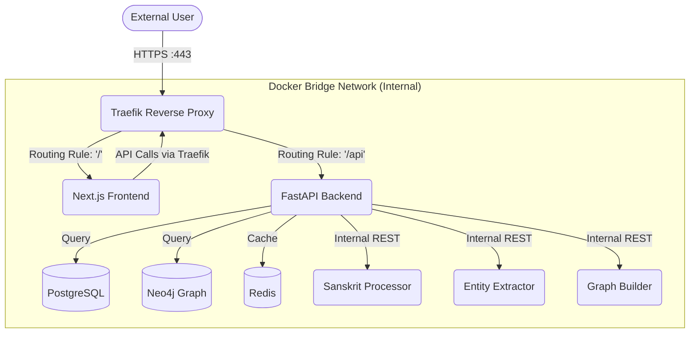

# Shloka-AFI Comprehensive Project Documentation

## 1. Overview
Shloka-AFI is a full-stack, multi-agent AI system designed to process Sanskrit shlokas from Ayurvedic texts and extract actionable medical knowledge. The platform translates ancient texts, extracts entities (Ingredients, Doshas, Diseases), and builds a queryable Neo4j Knowledge Graph. Furthermore, the platform features an immersive Next.js + React Three Fiber WebGL Virtual Reality "Pathshala" for interactive learning.

---

## 2. Architecture

The platform follows a microservices architecture, heavily decoupled for scalability.

### Core Stack
- **Frontend**: Next.js 14 (App Router), React, React Three Fiber (WebGL), TailwindCSS.
- **Backend Core**: FastAPI (Python), handling orchestration, auth, and SQL database interactions.
- **AI Microservices**: Specialized FastAPI services for NLP processing, Entity Extraction, and Graph Building.
- **Databases**: 
  - **PostgreSQL (pgvector)**: Relational data and semantic embeddings cache.
  - **Neo4j**: Graph database for Ayurvedic ontology mappings.
  - **Redis**: Fast caching layer.

### System Data Flow


---

## 3. Networking & Security

The infrastructure operates under strict security guidelines, aligned with **OWASP Top 10 (2025)** standards.

### Traefik Reverse Proxy
All incoming traffic is captured by **Traefik**, functioning as the singular ingress point. It dynamically routes requests based on Docker labels:
- Requests starting with `/api` are routed to the Backend.
- All other requests are routed to the Frontend.

### Network Isolation (Zero Trust Internal)
- Microservices (`sanskrit_processor`, `entity_extractor`, `graph_builder`) and databases (`postgres`, `neo4j`, `redis`) **do not expose any ports to the host machine**.
- They are only accessible by the Backend container via the internal Docker bridge network.

### Security Hardening Features
1. **Anti-Enumeration**: Registration and Password Reset endpoints return generic responses to prevent attackers from discovering registered emails.
2. **Cryptographic Security**: Passwords use `bcrypt`. OTPs are generated via CSPRNG (`secrets`) and stored strictly as SHA-256 hashes.
3. **Brute-Force Lockout**: Accounts temporarily lock after 5 failed OTP attempts.
4. **Rate Limiting**: `slowapi` enforces strict rate limits on authentication and heavy pipeline endpoints.
5. **CORS & Headers**: Strict CORS origins and enforced Security Headers (HSTS, XSS-Protection).

---

## 4. Setup & Docker Deployment

The platform is designed to be deployed via Docker Compose.

### Prerequisites
- Docker Engine & Docker Compose
- `.env` file configured with Database credentials, `API_SECRET_KEY`, `GROQ_API_KEY`, and `BREVO` email credentials.

### Deployment Commands
```bash
# Build and start all services in detached mode
docker compose up --build -d

# Check the status of all containers
docker compose ps

# View logs for the backend specifically
docker logs shloka_backend -f
```

### Dockerfile Strategy
- The Next.js frontend uses a **multi-stage build** to strip out `node_modules` development dependencies, resulting in a lightweight production image.
- Python backends use `python:3.11-slim` to minimize image bloat and attack surface.

---

## 5. Module-wise Breakdown

### `shloka_frontend` (Next.js)
Handles the user interface, protected routes (via Next-Auth middleware), and the VR Pathshala room. Communicates exclusively with the backend via the Traefik router.

### `shloka_backend` (FastAPI)
The primary orchestrator. Handles user authentication, issues JWTs, logs audit events, manages SQL interactions, and triggers the AI pipeline by dispatching tasks to the internal microservices.

### `sanskrit_processor`
Responsible for transliteration, translation, and meaning extraction. Integrates with LLMs (e.g., Groq LLaMA) and checks semantic caching (pgvector) to prevent redundant processing of highly similar texts.

### `entity_extractor`
Takes normalized text and specifically targets Ayurvedic entities: Doshas, Rasas, Karmas, Diseases, and Herbs/Ingredients.

### `graph_builder`
Translates extracted entities into Neo4j Cypher queries. Structures the `BALANCES`, `TREATS`, and `CONTAINS` relationships.

---

## 6. API Documentation

All endpoints are prefixed with `/api/v1`. Authenticated routes require a `Bearer <JWT>` in the Authorization header.

### Authentication Endpoints
- **`POST /auth/register`**: Creates an account (Sends Verification Email).
- **`POST /auth/verify-email`**: Validates email ownership via OTP.
- **`POST /auth/login`**: Checks credentials and sends Login OTP.
- **`POST /auth/verify-otp`**: Validates OTP and returns JWT.
- **`POST /auth/forgot-password`**: Triggers password reset flow.
- **`POST /auth/reset-password`**: Executes password reset using emailed token.
- **`POST /auth/logout`**: Blacklists current JWT.

### Core Processing Endpoints (Authenticated)
- **`POST /pipeline`**: Triggers the full Shloka processing pipeline (NLP -> Graph).
- **`POST /bulk-upload`**: Parses CSV/PDF files and batch-processes multiple shlokas.
- **`GET /shlokas`**: Retrieves processed shlokas from the Postgres database.
- **`GET /graph/full`**: Retrieves the complete Neo4j ontology.

---

## 7. Database Schema

### PostgreSQL Schema
- **`users`**: Stores authentication data, hashed passwords, hashed OTPs, and lockout counters.
- **`shlokas`**: Stores original text, translation, JSON-serialized entities, and a `vector` column (via pgvector) for semantic caching.
- **`audit_logs`**: Tracks every `POST`/`PUT`/`DELETE` request mapped to IPs/Users.
- **`blacklisted_tokens`**: Stores revoked JWTs.

### Neo4j Graph Ontology
- **Nodes**: `Herb`, `Dosha`, `Disease`, `Karma`, `Rasa`.
- **Relationships**: 
  - `(Herb)-[:BALANCES]->(Dosha)`
  - `(Herb)-[:TREATS]->(Disease)`
  - `(Herb)-[:HAS_TASTE]->(Rasa)`

---

## 8. Known Issues
1. **Cold Starts**: If LLM endpoints (Groq) experience high latency, the `sanskrit_processor` pipeline can timeout.
2. **Semantic Graph Duplicates**: While Neo4j's `MERGE` prevents structural duplicates, slight naming variations (e.g., "Ashwagandha" vs "Ashwagandha Root") will create distinct nodes. 

---

## 9. Future Scope
1. **Semantic Entity Resolution**: Implement a vector-based similarity check *before* Neo4j ingestion to automatically merge synonymous entities.
2. **Cloud Migration (AWS/GCP)**: 
   - Move secrets out of `.env` and into AWS Secrets Manager.
   - Transition local Postgres and Neo4j to managed services (AWS RDS, Neo4j AuraDB) for automated backups and encryption at rest.
3. **Cloudflare WAF**: Implement Cloudflare in front of Traefik to provide volumetric DDoS protection and Edge-level request filtering.
